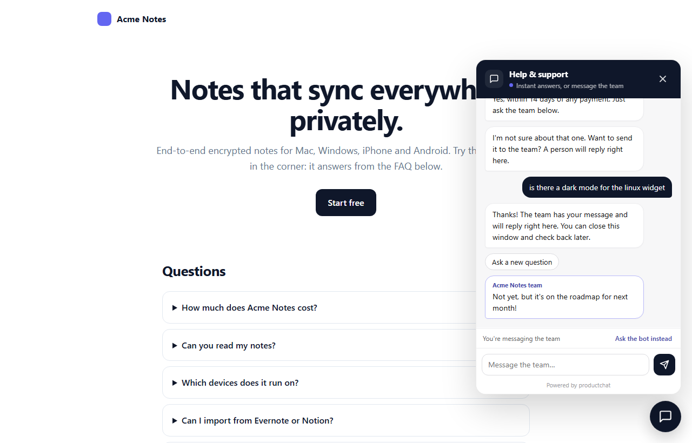
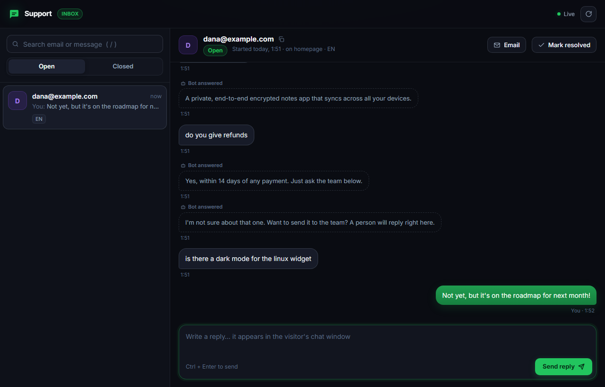
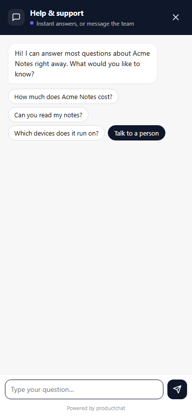

# productchat

**Self-hosted support chat for product sites.** A chat bubble that answers from your page's own FAQ instantly, hands off to you when it can't, and lets you reply from a private inbox or straight from Telegram.

One script tag, one API route, one Postgres database. No accounts, no per-seat pricing, no third-party chat scripts reading your visitors' messages.



## Why

Most chat tools are a monthly subscription plus a heavy script that phones home on every page view. productchat is the other way round:

- **Answers first, for free.** The bot reads the FAQ already on your page (any language) plus a few extra answers you add. No AI bill, no training.
- **Private by default.** Nothing leaves the visitor's browser until they choose to message you. Then it goes to *your* database.
- **Reply from your phone.** New chats ping you on Telegram. Reply to the alert and the visitor sees it in their chat window.
- **Tiny.** One ~30 KB script (10 KB gzipped), loaded in a shadow DOM so your CSS and theirs never clash. It only talks to your server once someone asks for a person.
- **Free to run.** Fits on Vercel's free tier with a free Postgres (Supabase, Neon, …).

| | |
|---|---|
|  |  |

## Quick start (about 5 minutes)

**1. Install**

```bash
npm i productchat
```

You need a Postgres database. Set `DATABASE_URL`; the tables are created on first use (or print them with `npx productchat schema`).

**2. Add the API route.** On Vercel, create `api/productchat.js`:

```js
import { createProductChat } from "productchat/server";

export default createProductChat({
  siteName: "Acme",
  inboxUrl: "https://acme.com/support/inbox",
}).vercel();
```

<details><summary>Express or plain Node.js</summary>

```js
// Express
app.post("/api/productchat", express.json(), chat.express());

// Node http
http.createServer((req, res) => req.url.startsWith("/api/productchat") ? chat.node()(req, res) : …);
```

Or run the whole thing with no framework: `DATABASE_URL=… node node_modules/productchat/examples/node-server.mjs`.
</details>

**3. Add the widget** to your page. Copy `node_modules/productchat/widget/productchat.js` to your public folder, then:

```html
<script>
  window.productchatConfig = {
    brand: "Acme",
    faq: { items: "details", question: "summary", answer: ".answer" },
  };
</script>
<script src="/productchat.js" defer></script>
```

**4. Host the inbox.** Copy `node_modules/productchat/inbox/index.html` to e.g. `/support/inbox`. Set your brand in its `<meta name="productchat-brand">` tag.

**5. Get your inbox link.**

```bash
npx productchat inbox-link --url https://acme.com/support/inbox
```

Open the link once on each device you'll answer from. It's the only key to your inbox, so keep it private. `--revoke` cancels old links.

## Telegram (optional, recommended)

1. Create a bot with [@BotFather](https://t.me/BotFather) and press **Start** in a chat with it.
2. Get your chat ID from [@userinfobot](https://t.me/userinfobot).
3. Set `TELEGRAM_BOT_TOKEN` and `TELEGRAM_CHAT_ID` on your server. Test with `npx productchat telegram-test`.

That gives you alerts. **Alerts work with any bot, even one you already use for something else**: productchat only sends through it.

To **reply from Telegram**, use a bot made just for productchat (@BotFather → `/newbot`, about a minute). Telegram delivers a bot's incoming messages to one app only, so a bot of its own means nothing else can ever clash with it. Then:

```bash
npx productchat telegram-webhook https://acme.com/api/productchat --yes
```

It prints a `TELEGRAM_WEBHOOK_SECRET`; add it to your server's environment and redeploy. Now reply to any 💬 alert to answer that visitor, `/resolve` to close the chat, `/reopen` to open it again. Only your chat ID is accepted, and every update must carry the secret.

The command won't take a bot away from another app: if the bot already delivers its messages somewhere else, it stops and changes nothing.

## Widget options

All optional. Set `window.productchatConfig` before the script loads.

| Option | Default | |
|---|---|---|
| `api` | `"/api/productchat"` | Your API route. |
| `brand` | `"Support"` | Used in the greeting and "Acme team". |
| `accent`, `dark` | `"#22c55e"`, `"#111111"` | Accent colour and the dark colour for the header and buttons. |
| `logo` | chat icon | An image URL or an inline `<svg>`. |
| `faq` | `{ items: "details", question: "summary", answer: "" }` | Where your FAQ lives. `answer: ""` means "everything in the item except the question". `keyAttr` (default `data-key`) names an attribute used to reference entries in `chips`. `false` turns it off. |
| `knowledge` | `[]` | Extra answers: `{ q, a, k, id }`. `a` is HTML, `k` is extra keywords. An entry with `id: "about"` answers "what is Acme?". |
| `chips` | first 3 FAQ questions | Quick questions on the greeting: `[{ label, match }]`, where `match` is an entry's key, id or question. |
| `synonyms` | built-in set | Map words to the same token: `{ evernote: "import" }`. |
| `stopwords` | — | Extra words to ignore (your brand name is ignored automatically). |
| `strings` | English | Override any text: `greeting`, `title`, `subtitle`, `human`, `sent`, … (see the top of `productchat.js`). Use this for translations. |
| `privacyUrl` | `"/privacy"` | Linked under the email field. `""` hides it. |
| `position` | `"right"` | Or `"left"`. |
| `storageKey` | `"productchat"` | localStorage key for the visitor's conversation. |
| `poweredBy` | `true` | The small "Powered by productchat" link. |

`window.ProductChat.open()` opens the chat from your own button.

## Server options

```js
createProductChat({
  databaseUrl,      // or `pool` (any pg-compatible pool); defaults to DATABASE_URL
  siteName,         // shown in Telegram alerts
  inboxUrl,         // for the "Open conversation" button in alerts
  telegram: { botToken, chatId, webhookSecret }, // default: TELEGRAM_* env vars
  tables: { conversations, messages, inboxKeys, telegram }, // rename tables if you need to
  limits: { startsPerIpHour: 5, messagesPerConversationHour: 30 },
  cors: false,      // true or an origin, if the widget runs on another domain
  onError: (err) => console.error(err),
});
```

## How the bot decides

Each FAQ entry is turned into weighted words: words in the question and your keywords count three times as much as words in the answer, with synonyms folded together and Chinese, Japanese and Korean text handled by character pairs. A clear winner is answered. Close calls show "Did you mean…" with the top three. Anything else is offered to a person, along with the visitor's earlier questions so you have the context.

## Security notes

- Visitor conversations are identified by a random token held in their browser; the server stores only its SHA-256 hash. Same for inbox keys.
- Starting chats is rate-limited per IP (stored hashed), and messages per conversation. There's a honeypot field for bots.
- Visitor and team messages are always rendered as text. Only your own FAQ and `knowledge` HTML is rendered as HTML.
- Row-level security is enabled on every table, so on Supabase the public REST API can't read them.

## Built by PhishClean

productchat runs the support chat on [phishclean.com](https://www.phishclean.com), the privacy-first anti-phishing extension, and was extracted from it. MIT licensed. Issues and pull requests welcome.
